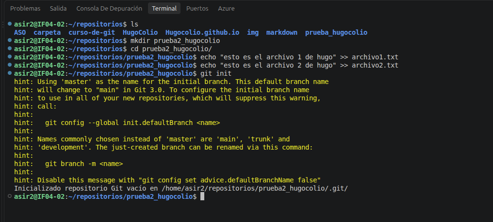
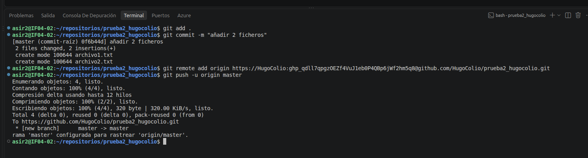
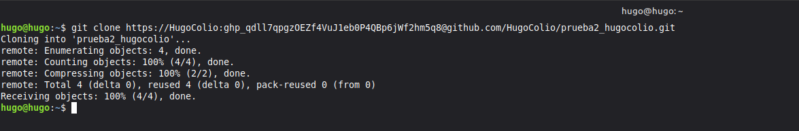
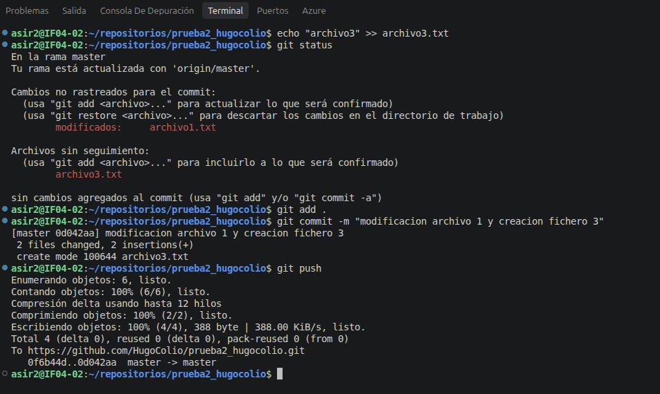
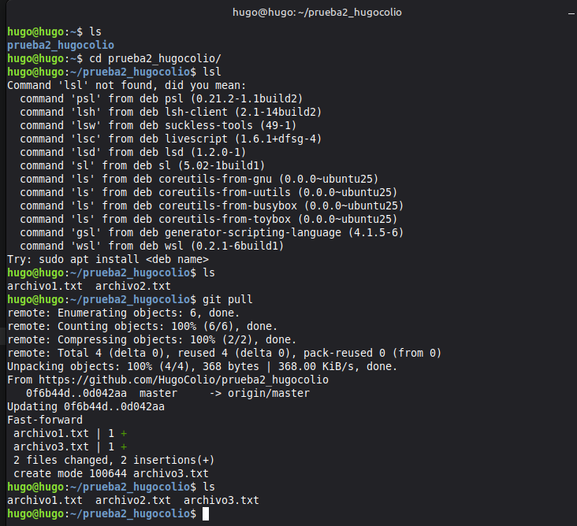

# Documentación de Práctica: Git & GitHub  

### 1. Inicialización del Repositorio Local 
**Aquí he creado un repositorio local usando git.**   
  

---  

### 2. Vinculación y Subida Remota 
**Aquí he conectado el repositorio local con el de github y lo subido.**   
  

---  

### 3. Clonación en Entorno Debian 
**Ahora en una maquina debian lo he clonando.**   
  

---  

### 4. Edición de Archivos y Push 
**Aquí he modificado uno de los archivos y he creado un fichero 3.**   
  

---  

### 5. Sincronización Final (Pull) 
**Ahora he actualizado la version de debian con un pull.**   

